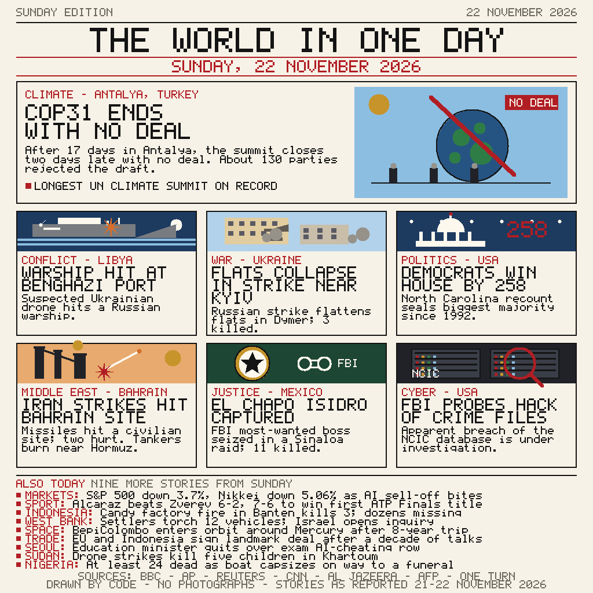

# news-image-20261122-v3

[](https://make.fun/bounty/news-image-20261122?utm_source=github&utm_medium=readme&utm_campaign=news-image-20261122)
[](https://make.fun/bounty/news-image-20261122/leaderboard?utm_source=github&utm_medium=readme&utm_campaign=news-image-20261122)
[](https://make.fun/bounty/news-image-20261122?utm_source=github&utm_medium=readme&utm_campaign=news-image-20261122)

The world in one day — a broadsheet front page for Sunday, 22 November 2026, drawn entirely in code. The COP31 climate talks collapse in Antalya leads the page; six illustrated cards and a nine-story ticker carry the rest of the day, from a warship hit at Benghazi to Alcaraz winning his first ATP Finals title. Sixteen real stories in all, each checked against reporting from 21–22 November 2026 (see SOURCES.md).



## Run it

```sh
mkdir -p out && MAKEFUN_OUTPUT_DIR=out python3 main.py
```

`main.py` uses only the Python standard library. It writes `entry.png` (1024×1024, under 1 MiB). Running it twice produces byte-identical output — no network, no randomness, no wall clock.

---

<sub>Entered on [make.fun](https://make.fun/bounty/news-image-20261122) for the news-image-20261122 bounty.</sub>
